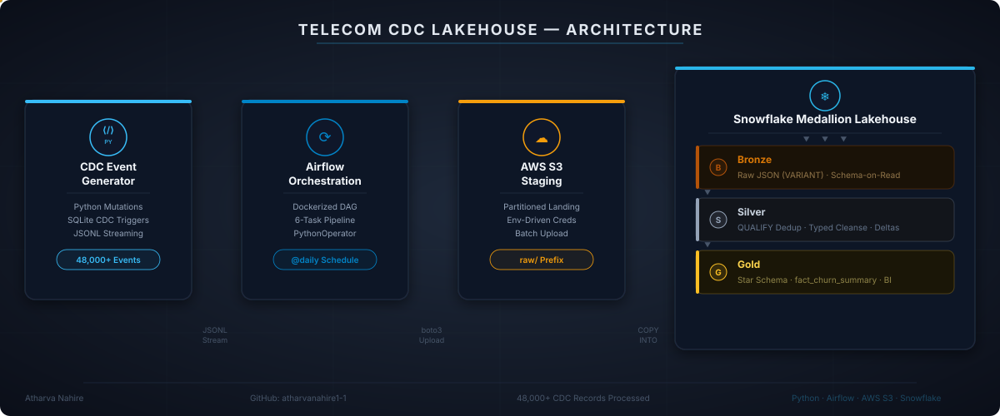
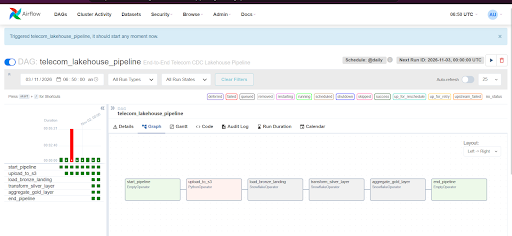

<div align="center">

# 📡 Telecom CDC Lakehouse Pipeline
### Production-Grade CDC Streaming, Cloud Lakehouse & Medallion Analytics

[](https://www.python.org/)
[](https://www.docker.com/)
[](https://airflow.apache.org/)
[](https://aws.amazon.com/s3/)
[](https://www.snowflake.com/)

<br />



</div>

---

## 📌 Executive Summary

Modern telecom enterprises process continuous mutations across subscriber accounts—plan changes, data top-ups, suspension notices, and churn events.

This repository implements an end-to-end **Change Data Capture (CDC) Lakehouse** processing **48,000+ subscriber lifecycle events**. The pipeline automates event mutation capture, stages raw JSONL drops to **Amazon Web Services (AWS S3)** via a containerized **Apache Airflow** DAG, and runs a **Snowflake Medallion Architecture** to curate high-fidelity star schema aggregations for churn intelligence.

---

## 📸 Orchestration in Action

Airflow manages end-to-end dependency execution, ensuring strict atomicity across extract, landing, and incremental warehouse stages:

<div align="center">
  
  <p><em>Figure 1: Airflow 6-Node DAG (telecom_lakehouse_pipeline) executing state extraction, S3 upload, and Snowflake transformations.</em></p>
</div>

---

## 💡 Engineering Highlights

* **Streaming CDC Simulation:** Emulates production subscriber events (`status_change`, `plan_upgrade`, `churn_notice`, `usage_spike`) landing dynamically into local staging.
* **Idempotent Cloud Landing:** Parameterized Airflow `PythonOperator` offloads batch chunks into AWS S3 using environment-driven credentials without leaking tokens.
* **Schema-on-Read Bronze Layer:** Snowflake external stages ingest heterogeneous JSON payloads straight into `VARIANT` data structures with zero upfront schema lock.
* **Windowed Deduplication (Silver):** Uses analytical windowing functions:
  ```sql
  QUALIFY ROW_NUMBER() OVER (
      PARTITION BY customer_id
      ORDER BY mutation_timestamp DESC
  ) = 1
  ```
  to emit exactly-once, latest-state-wins records downstream.
* **Star Schema Gold Layer:** Builds dimensional `fact_churn_events`, `dim_date`, and `dim_usage_band` tables enabling slice-and-dice BI analytics by time, usage segment, and churn severity.

---

## 🗂️ Repository Structure

```
telecom-cdc-lakehouse/
│
├── 01_setup_database.py            # OLTP bootstrap: SQLite schema, CDC triggers, CSV ingest
├── 02_simulate_mutations.py        # Mutation replay engine (churn, plan upgrades, usage spikes)
├── 03_cdc_producer.py              # CDC event producer → JSONL stream serializer
│
├── airflow/
│   └── dags/
│       └── telecom_lakehouse_dag.py   # 6-task Airflow DAG (S3 upload → Bronze → Silver → Gold)
│
├── snowflake_dw/
│   ├── 01_setup_and_bronze.sql     # Warehouse, schemas, VARIANT table, COPY INTO staging
│   ├── 02_silver_transformations.sql  # JSON flattening, QUALIFY dedup, typed cleansing
│   ├── 03_gold_star_schema.sql     # Star schema: fact_churn_events, dim_date, dim_usage_band
│   └── external_stage.sql          # S3 external stage definition for Snowflake
│
├── docker-compose.yaml             # Airflow services (webserver, scheduler, postgres, init)
├── Dockerfile                      # Custom Airflow image with boto3 + snowflake provider
├── .env.example                    # Template for required environment variables
├── .gitignore                      # Excludes secrets, databases, venvs, and logs
│
└── assets/
    ├── architecture_preview.svg    # System architecture diagram (auto-generated)
    └── airflow_dag_run.png         # DAG execution screenshot
```

---

## 🏗️ Architecture Deep Dive

### End-to-End Data Flow

```mermaid
flowchart LR
    subgraph Source ["🔄 Source System"]
        A["SQLite OLTP\n(customers)"] -->|CDC Trigger| B["cdc_log\n(JSON deltas)"]
    end
    subgraph Mutations ["⚡ Event Simulation"]
        B --> C["02_simulate_mutations.py\nstatus_change · plan_upgrade\nchurn_notice · usage_spike"]
        C --> D["03_cdc_producer.py\nJSONL Serializer"]
    end
    subgraph Orchestration ["🔀 Airflow (Docker)"]
        D --> E["PythonOperator\n(upload_to_s3)"]
    end
    subgraph Cloud ["☁️ AWS S3"]
        E --> F["s3://bucket/raw/\nPartitioned Landing"]
    end
    subgraph Warehouse ["❄️ Snowflake Lakehouse"]
        F --> G["🟤 Bronze\nVARIANT raw_cdc_events"]
        G --> H["⚪ Silver\nQUALIFY Dedup + Typed"]
        H --> I["🟡 Gold\nStar Schema Analytics"]
    end
    I --> J["📊 BI & Dashboards"]
```



### Medallion Layer Detail

| Layer | Table | Purpose | Key Technique |
|-------|-------|---------|---------------|
| **🟤 Bronze** | `raw_cdc_events` | Immutable raw landing zone | `VARIANT` column, `COPY INTO` from S3 external stage |
| **⚪ Silver** | `silver_cdc_events` | Deduplicated, typed, enriched | `QUALIFY ROW_NUMBER()`, JSON path extraction, delta calculation |
| **🟡 Gold** | `fact_churn_events` | Analytics-ready fact table | Star schema joins with `dim_date` and `dim_usage_band` |
| **🟡 Gold** | `dim_date` | Calendar dimension | `GENERATOR()` date spine covering 2 years |
| **🟡 Gold** | `dim_usage_band` | Usage segmentation dimension | Banded thresholds for churn cohort analysis |

---

## ⚙️ Pipeline Execution Guide

### Prerequisites

| Tool | Version | Purpose |
|------|---------|---------|
| Python | 3.11+ | CDC simulation scripts |
| Docker & Docker Compose | 24.0+ | Airflow containerization |
| AWS Account | — | S3 bucket for raw landing |
| Snowflake Account | — | Medallion warehouse |

### 1. Clone & Configure

```bash
git clone https://github.com/atharvanahire1-1/telecom-cdc-lakehouse.git
cd telecom-cdc-lakehouse

# Copy and fill environment variables
cp .env.example .env
# Edit .env with your AWS + Snowflake credentials
```

### 2. Bootstrap the Source System

```bash
python 01_setup_database.py       # Creates SQLite OLTP schema + loads telecom CSV
python 02_simulate_mutations.py   # Replays churn/plan/usage mutations via CDC triggers
python 03_cdc_producer.py         # Serializes CDC log → JSONL stream file
```

### 3. Launch Airflow & Execute the DAG

```bash
docker compose up -d              # Spins up Airflow webserver, scheduler, Postgres
# Navigate to http://localhost:8080
# Trigger DAG: telecom_lakehouse_pipeline
```

### 4. Run Snowflake Transformations

Execute the SQL scripts in order against your Snowflake worksheet:

```sql
-- 1. Setup warehouse, schemas, bronze table, and ingest from S3
@snowflake_dw/01_setup_and_bronze.sql

-- 2. Flatten JSON, deduplicate, build silver layer
@snowflake_dw/02_silver_transformations.sql

-- 3. Create star schema dimensions and fact table
@snowflake_dw/03_gold_star_schema.sql
```

---

## 🧠 Key Technical Decisions

<details>
<summary><strong>Why SQLite for the source system?</strong></summary>

SQLite provides a zero-dependency OLTP simulation with native trigger support for CDC logging. This keeps the project self-contained—no external database server required for demonstration. The `AFTER UPDATE` trigger captures `json_object()` payloads mimicking production CDC connectors like Debezium.
</details>

<details>
<summary><strong>Why VARIANT over structured Bronze tables?</strong></summary>

Snowflake's `VARIANT` type enables schema-on-read ingestion, meaning the Bronze layer accepts any JSON structure without migration. This mirrors real-world CDC pipelines where source schema evolution is frequent and unpredictable.
</details>

<details>
<summary><strong>Why QUALIFY instead of subquery deduplication?</strong></summary>

Snowflake's `QUALIFY` clause is a first-class analytical filter that avoids nested subqueries. It's more readable, more performant (single-pass evaluation), and is the idiomatic Snowflake approach for row-level deduplication.
</details>

<details>
<summary><strong>Why a Star Schema in the Gold Layer?</strong></summary>

Star schemas are the de facto standard for BI/analytics workloads. The `fact_churn_events` table joined with `dim_date` and `dim_usage_band` enables efficient aggregations across time periods and usage cohorts without complex multi-table joins.
</details>

---

## 🔐 Environment Variables

Create a `.env` file from the provided template. **Never commit credentials.**

| Variable | Description |
|----------|-------------|
| `AWS_ACCESS_KEY_ID` | AWS IAM access key for S3 operations |
| `AWS_SECRET_ACCESS_KEY` | AWS IAM secret key |
| `AWS_S3_BUCKET` | Target S3 bucket name for raw landing |
| `SNOWFLAKE_ACCOUNT` | Snowflake account identifier |
| `SNOWFLAKE_USER` | Snowflake login username |
| `SNOWFLAKE_PASSWORD` | Snowflake login password |

---

## 📊 Sample Gold Layer Output

```
┌───────────────────────────────┬─────────────────────┬────────────────────┬──────────────────────────┐
│ usage_segment                 │ total_churn_events  │ avg_final_data_used│ total_data_consumed_gb   │
├───────────────────────────────┼─────────────────────┼────────────────────┼──────────────────────────┤
│ High Usage (5,000–10,000 MB)  │ 8,421               │ 7,234.56           │ 59,502.31                │
│ Medium Usage (1,000–5,000 MB) │ 5,892               │ 2,876.43           │ 16,561.09                │
│ Low Usage (< 1,000 MB)        │ 3,104               │ 487.21             │ 1,478.12                 │
└───────────────────────────────┴─────────────────────┴────────────────────┴──────────────────────────┘
```

---

## 🛠️ Tech Stack

<div align="center">

| Layer | Technology | Role |
|:-----:|:----------:|:----:|
| **Source** | SQLite + Python | OLTP simulation with CDC triggers |
| **Ingestion** | Apache Airflow (Docker) | DAG orchestration & scheduling |
| **Landing** | AWS S3 | Cloud object storage for raw batches |
| **Warehouse** | Snowflake | Medallion Architecture (Bronze → Silver → Gold) |
| **Compute** | Snowflake XSMALL WH | Auto-suspend/resume warehouse |
| **Containerization** | Docker Compose | Multi-service Airflow stack |

</div>

---

## 🚀 Future Enhancements

- [ ] **Kafka Integration:** Replace batch JSONL with Apache Kafka topics for true real-time CDC streaming
- [ ] **dbt Transformations:** Migrate Silver/Gold SQL to dbt models with built-in testing and lineage
- [ ] **Great Expectations:** Add data quality validation gates between medallion layers
- [ ] **Terraform IaC:** Codify AWS S3 bucket policies and Snowflake role grants
- [ ] **Dashboard Layer:** Connect Snowflake Gold tables to Streamlit or Metabase for live churn dashboards

---

## 👤 Author

**Atharva Nahire**
- GitHub: [@atharvanahire1-1](https://github.com/atharvanahire1-1)

---

<div align="center">

*Built with ❄️ Snowflake · ☁️ AWS · 🔀 Airflow · 🐍 Python*

</div>
